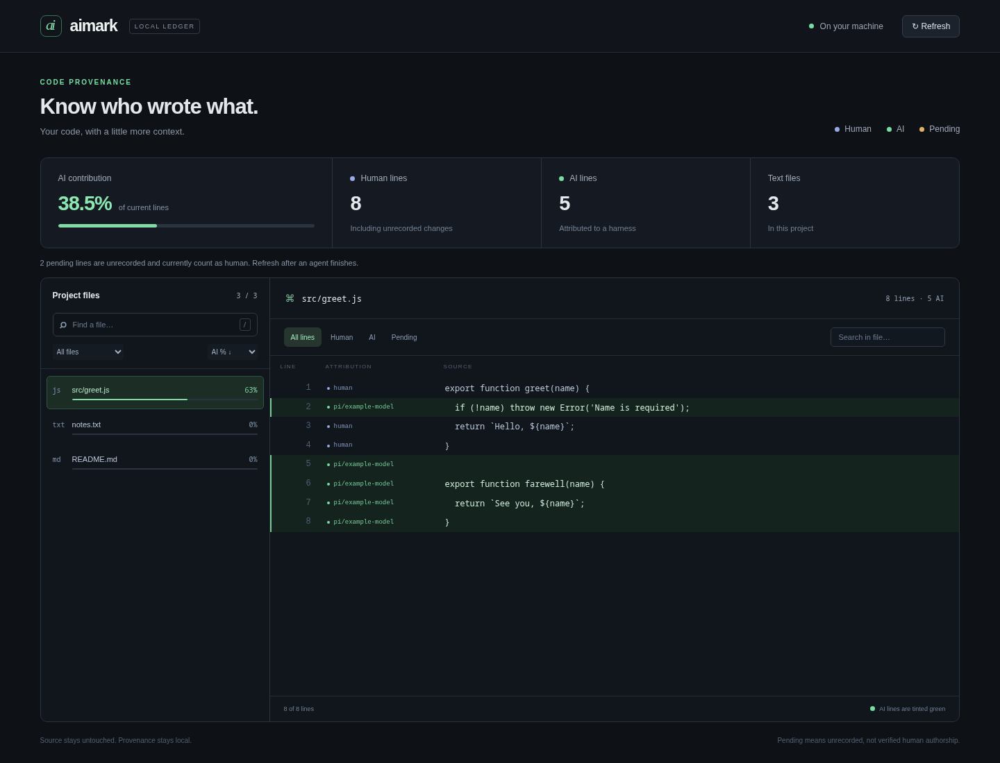

# aimark

See which lines came from a human and which came from an AI harness, without adding markers to your code.

aimark keeps snapshots in a separate Git ledger under `.aimark/`. The CLI and local browser dashboard show attribution for the current working tree. Nothing is uploaded.



## Install

Requires Rust 1.89 or newer and Git 2.28 or newer.

```sh
cargo install --path . --locked
```

Or run directly from this checkout with `cargo run -- <command>`.

## Quick start

In the project you want to track:

```sh
aimark checkpoint
aimark run --harness codex -- codex
aimark dashboard
```

Open the printed address, normally `http://127.0.0.1:4242`. The dashboard shows project totals, searchable files, and a source viewer with human, AI, and pending line filters. Hover an attribution label for its commit. Use Refresh after edits. Press `/` to search files.

`aimark dashboard --port 0` chooses an available port. The server binds only to loopback and embeds all its assets. It needs no Node.js installation.

To inspect the example project without touching your own source:

```sh
just demo
just demo-dashboard
```

## Record edits

Every AI edit needs a human snapshot before it and an AI snapshot after it:

```sh
aimark checkpoint --files src/main.rs
# The agent edits src/main.rs here.
aimark record --harness pi --model example-model --files src/main.rs
aimark blame src/main.rs
aimark stat
```

Use `--files` repeatedly for multiple files or directories. Each argument is a literal path. Commas, spaces, and brackets belong to the filename and are not separators or patterns. A scoped snapshot leaves unrelated pending changes alone. Omitting `--files` snapshots the entire eligible project.

The root is the nearest ancestor containing `.aimark/` or `.git`, falling back to the current directory. Pass `--root .` to start an independent project inside another tracked directory. With an explicit `--root`, file arguments are relative to that root. Otherwise they are relative to your current directory. Absolute paths within the root also work.

## Commands

| Command | Purpose |
| --- | --- |
| `init` | Create an empty ledger without snapshotting existing files |
| `checkpoint [--files PATH]` | Snapshot human changes before AI work |
| `record --harness NAME [--model NAME] [--session ID] [--files PATH]` | Snapshot AI changes |
| `run --harness NAME [--model NAME] [--session ID] -- COMMAND ...` | Snapshot before and after a command |
| `blame FILE [--json]` | Inspect current line attribution |
| `stat [--json]` | Show AI percentage per file and overall |
| `dashboard [--port PORT]` | Serve the local browser dashboard |
| `hook claude` | Handle Claude file-tool hook JSON from stdin |

`run` starts the command in your current directory and preserves its exit code. It records changes even after failure. On Unix it forwards `SIGINT`, `SIGTERM`, and `SIGHUP` to the direct child and records partial edits before returning. Uncatchable termination, such as `SIGKILL`, cannot trigger a final snapshot. On Windows, normal command completion and failure are supported; interruption capture is Unix-only.

## Harness integrations

### Claude Code

Install aimark on `PATH`, then merge [integrations/claude/settings.json](integrations/claude/settings.json) into your project's `.claude/settings.json`. Preserve any hooks already configured there. The supplied commands use the POSIX shell syntax supported by Claude Code on macOS, Linux, and Git Bash.

The same `aimark hook claude` command handles before, after, and failed file-tool events. It reads the target path and session from the payload and the latest model from the transcript when available. Missing model information becomes `unknown`. A malformed payload fails instead of recording the entire project.

Hook errors return exit code 2, so Claude blocks a file edit when its before-edit checkpoint fails.

These hooks cover `Edit`, `Write`, `MultiEdit`, and `NotebookEdit`. Shell commands and custom tools that write files need wrapper coverage instead:

```sh
aimark run --harness claude-code -- claude
```

Choose hooks for file-tool attribution or the wrapper for session-wide attribution. Avoid combining them in one session, because a wrapper's final snapshot also includes pending human edits.

The older `record --harness claude-code --stdin claude` form remains available for existing two-phase hook configurations. Use the supplied scoped `hook claude` configuration for new setups.

### pi

Copy [integrations/pi/aimark.ts](integrations/pi/aimark.ts) into `.pi/extensions/aimark.ts` in the project you want to track, or load it directly:

```sh
pi -e ./integrations/pi/aimark.ts
```

The extension checkpoints before `write` and `edit`, records afterward using the current model and session, and adds `/aimark` for a quick percentage summary. It blocks a file edit if its checkpoint cannot be saved. It reports recording failures through pi's UI, or stderr without a UI. The extension's type import uses the current `@earendil-works/pi-coding-agent` package name; pi loads the TypeScript module directly.

For shell writes, custom tools, or older pi versions, use the universal wrapper instead:

```sh
aimark run --harness pi -- pi
```

The adapter follows the [official pi extension API](https://github.com/badlogic/pi-mono/blob/main/packages/coding-agent/docs/extensions.md). Claude configuration follows the [official hook reference](https://code.claude.com/docs/en/hooks).

### Other harnesses

The wrapper works with any local command. You can also call `checkpoint --files PATH` before a tool and `record --files PATH` afterward from a harness plugin. Pass the actual model name if the harness exposes it.

## Attribution rules

- Unchanged lines keep their previous attribution. Whitespace-only changes are ignored by blame. Git also detects some moves and renames.
- Unrecorded lines count as human and have `pending: true`. This means their origin has not been recorded. It is not a claim that a human wrote them.
- Reports never commit pending changes. Looking at the dashboard during an edit cannot turn that edit into a human checkpoint.
- Snapshots honor worktree `.gitignore` files. Files already in the ledger stay tracked until removed, following Git's usual behavior. The real repository's local excludes and global ignore settings are separate from the ledger.
- Reports inspect UTF-8 text files up to 1,000,000 bytes. Binary files, symlinks, and larger files are skipped and counted. Empty text files appear with zero lines. Snapshots can still contain binary or large files.
- Ledger operations use an OS file lock. Scoped hooks can track overlapping edits to different files. Concurrent edits to the same file, simultaneous wrappers, and human edits during a wrapper run cannot be separated reliably.
- Nested Git repositories and submodules are separate tracking boundaries. Initialize and inspect them independently with `--root`; the parent's report does not include their source lines.

The ledger has its own history and index. aimark adds `/.aimark/` to the real repository's local exclude file when one exists, including linked worktrees. Source files, the real Git index, and tracked ignore files stay untouched. Keep files you do not want snapshotted in `.gitignore` before the first checkpoint.

This is cooperative provenance. It cannot detect AI code pasted from a chat, reconstruct authorship before tracking started, or prevent someone from deleting or rewriting the ledger. Structural formatter rewrites may change attribution. The dashboard is read-only and has no account system; other users and processes on the same machine may reach its loopback port while it is running.

## JSON output

`blame --json` returns one object per line:

```json
{"line": 3, "ai": true, "pending": false, "author": "pi/example-model", "text": "    robot();", "commit": "..."}
```

`stat --json` returns `files`, `ai`, `human`, `pending`, `total`, `pct`, and `skipped`. Each file includes its path and the same line counts. Pending is a subset of human, so `human + ai = total`. Percentages refer to current lines, not historical effort.

## Development

```sh
just check
just test
just build
```

Rust tests exercise the real binary and Git in temporary projects. Dashboard tests need permission to bind loopback sockets.

Optional adapter and browser checks require Node.js 24 or newer:

```sh
cargo build
npm ci
npm run check
npm run test:pi
npx playwright install chromium
npm run test:browser
```

Browser tests cover attribution filters, file and source search, source escaping, mobile layout, and refresh. The app itself has no npm runtime dependencies.
